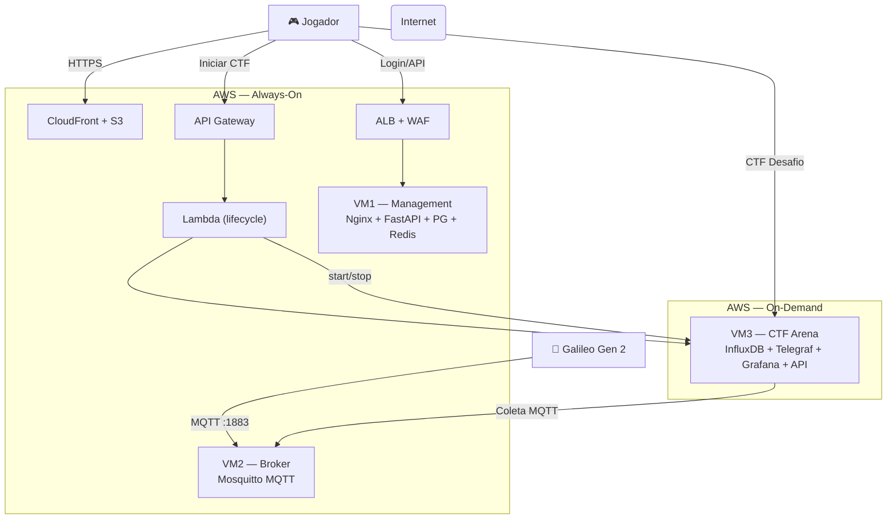

# Arquitetura do Sistema — CTF IIoT Dinâmico

## 1. Visão Geral

A plataforma é composta por três camadas principais que interagem entre si:

1. **Dispositivo de Borda (Edge)**: Intel Galileo Gen 2 rodando Yocto Linux, simulando sensores industriais reais.
2. **Infraestrutura de Nuvem (AWS)**: Três VMs com funções distintas + serviços gerenciados AWS.
3. **Portal do Jogador**: Frontend React servido via CloudFront/S3.

A topologia é projetada para ser **realista**, refletindo arquiteturas IIoT encontradas em ambientes industriais reais.

---

## 2. Topologia Completa

```
┌──────────────────────────────────────────────────────────────────────────────┐
│                              INTERNET                                        │
└────────────────┬──────────────────────────────────┬──────────────────────────┘
                 │                                  │
         HTTPS (443)                         MQTT (1883)
                 │                                  │
    ┌────────────▼──────────────┐      ┌────────────▼──────────────┐
    │     JOGADOR / PLAYER      │      │  INTEL GALILEO GEN 2      │
    │  (Browser / Terminal SSH) │      │  Sensor DHT22 + LDR       │
    └───────────────────────────┘      │  Yocto Linux (Dunfell)    │
                                       └───────────────────────────┘
                 │
     ┌───────────▼───────────────────────────────────────────────────────────┐
     │                          AWS CLOUD                                    │
     │                                                                       │
     │  ┌────────────────────────────────────────────────────────────────┐  │
     │  │            GERENCIAMENTO "ALWAYS-ON"                            │  │
     │  │                                                                  │  │
     │  │   CloudFront ──► S3                                              │  │
     │  │   (CDN/HTTPS)     (React App)                                   │  │
     │  │                                                                  │  │
     │  │   ALB ──► WAF                   API Gateway ──► Lambda          │  │
     │  │   (Load Balancer)  (Rate Limit)  (HTTP /session)  (start/stop)  │  │
     │  │                                                                  │  │
     │  │   ┌─────────── VM1: Management ────────────────────┐            │  │
     │  │   │ Nginx (reverse proxy + static files)            │            │  │
     │  │   │ FastAPI (auth, sessions, VM lifecycle)          │            │  │
     │  │   │ PostgreSQL (usuários, sessões)                  │            │  │
     │  │   │ Redis (contador de sessões, max 5)              │            │  │
     │  │   └────────────────────────────────────────────────┘            │  │
     │  └────────────────────────────────────────────────────────────────┘  │
     │                                                                       │
     │  ┌────────────────────────────────────────────────────────────────┐  │
     │  │            BROKER DEDICADO "ALWAYS-ON"                         │  │
     │  │                                                                  │  │
     │  │   ┌──────────── VM2: Broker ───────────────────────┐            │  │
     │  │   │ Mosquitto MQTT (porta 1883, TLS opcional)       │            │  │
     │  │   │ Recebe telemetria do Galileo Gen 2              │            │  │
     │  │   │ ACL configurada (com vulnerabilidade intencional│            │  │
     │  │   └────────────────────────────────────────────────┘            │  │
     │  └────────────────────────────────────────────────────────────────┘  │
     │                                                                       │
     │  ┌────────────────────────────────────────────────────────────────┐  │
     │  │            ARENA DO CTF "ON-DEMAND" (Docker)                   │  │
     │  │                                                                  │  │
     │  │   ┌──────────── VM3: CTF Arena ────────────────────┐            │  │
     │  │   │ Elastic IP Dedicado                             │            │  │
     │  │   │                                                 │            │  │
     │  │   │  ┌─────────────── Docker Compose ────────────┐ │            │  │
     │  │   │  │                                            │ │            │  │
     │  │   │  │  Telegraf ──► InfluxDB ──► Grafana (vuln) │ │            │  │
     │  │   │  │  (coleta)     (time-series) (dashboard)   │ │            │  │
     │  │   │  │                                            │ │            │  │
     │  │   │  │  Vulnerable API (isca/decoy FastAPI)       │ │            │  │
     │  │   │  │                                            │ │            │  │
     │  │   │  └────────────────────────────────────────────┘ │            │  │
     │  │   └────────────────────────────────────────────────┘            │  │
     │  └────────────────────────────────────────────────────────────────┘  │
     └───────────────────────────────────────────────────────────────────────┘
```

---

## 3. Componentes Detalhados

### 3.1 VM1 — Portal de Gerenciamento

| Atributo | Valor |
|----------|-------|
| Tipo EC2 | `t3.small` |
| SO | Ubuntu 22.04 LTS |
| IP | Elastic IP estático |
| Modo | Always-On |
| Porta exposta | 80 (HTTP via Nginx → HTTPS via CloudFront) |

**Serviços (todos nativos, sem Docker):**

- **Nginx**: Servidor web e reverse proxy. Serve os arquivos estáticos do fallback e redireciona `/api/*` para o FastAPI (Uvicorn na porta 8000).
- **FastAPI (backend_manager)**: Aplicação Python gerida pelo `systemd`. Responsável por:
  - Registro e login de usuários (bcrypt + JWT)
  - Controle de sessões concorrentes via Redis (máximo 5 jogadores simultâneos)
  - Trigger da Lambda para start/stop da VM3
  - Endpoint de health check
- **PostgreSQL**: Armazena usuários, hashes de senhas e histórico de sessões.
- **Redis**: Contador atômico de sessões ativas. Garante que `INCR` e `DECR` sejam thread-safe.

### 3.2 VM2 — Broker MQTT Dedicado

| Atributo | Valor |
|----------|-------|
| Tipo EC2 | `t3.micro` |
| SO | Ubuntu 22.04 LTS |
| IP | Elastic IP estático |
| Modo | Always-On |
| Porta exposta | 1883 (MQTT) |

**Serviços:**

- **Mosquitto**: Broker MQTT instalado nativamente via `apt`. Configurado com:
  - Autenticação por usuário/senha (`passwd_file`)
  - ACL para controle de tópicos por cliente
  - **⚠️ Vulnerabilidade intencional na ACL** (Flag 3) — veja `docs/vulnerabilities.md`

### 3.3 VM3 — Arena do CTF

| Atributo | Valor |
|----------|-------|
| Tipo EC2 | `t3.medium` |
| SO | Debian 12 (Bookworm) |
| IP | Elastic IP dedicado |
| Modo | On-Demand (ligada/desligada via Lambda) |
| Portas expostas | 80 (Grafana), 8086 (InfluxDB), 5000 (API), 22 (SSH) |

**Containers (Docker Compose):**

| Container | Imagem | Função |
|-----------|--------|--------|
| `influxdb` | `influxdb:1.8` | Banco de dados de séries temporais |
| `telegraf` | `telegraf:latest` | Coleta dados do Mosquitto e grava no InfluxDB |
| `grafana` | `grafana/grafana:8.3.0` | Dashboard **vulnerável** (CVE-2021-43798) |
| `vulnerable-api` | Build local | API FastAPI de isca para investigação |

### 3.4 Edge Device — Intel Galileo Gen 2

| Atributo | Valor |
|----------|-------|
| Hardware | Intel Galileo Gen 2 (Quark X1000, 400MHz, 256MB DDR3) |
| SO | Yocto Linux Dunfell 3.1.33 (kernel 3.8.7) |
| Conectividade | Ethernet (DHCP ou IP fixo configurável) |
| Sensores | DHT22 (temperatura/umidade via I2C), LDR (luminosidade via ADC) |
| Protocolo | MQTT (paho-mqtt Python) → VM2 porta 1883 |

**Script principal** (`sensor.py`): Lê os sensores, formata os dados como JSON e publica nos tópicos:
- `fabrica/sensor01/temperatura`
- `fabrica/sensor01/umidade`
- `fabrica/sensor01/luminosidade`

---

## 4. Fluxos de Comunicação

### 4.1 Fluxo do Jogador

```
1. Jogador acessa https://ctf.exemplo.com (CloudFront)
2. React App carrega do S3
3. Jogador faz login → POST /api/auth/login (FastAPI/VM1)
4. FastAPI verifica no PostgreSQL + incrementa contador no Redis
5. Jogador clica "Iniciar CTF" → POST /api/session/start (API Gateway)
6. API Gateway aciona Lambda → Lambda faz start_instances na VM3
7. VM3 inicializa → Docker Compose sobe os containers
8. Jogador recebe o Elastic IP da VM3 e começa o desafio
```

### 4.2 Fluxo dos Dados do Sensor

```
1. Galileo Gen 2 lê sensores a cada 5 segundos
2. sensor.py publica JSON em fabrica/sensor01/* via MQTT (porta 1883)
3. Mosquitto (VM2) recebe e distribui as mensagens
4. Telegraf (VM3, container) está inscrito no Mosquitto como subscriber
5. Telegraf grava os dados no InfluxDB (VM3, container)
6. Grafana (VM3, container) exibe os dados em tempo real no dashboard
```

### 4.3 Fluxo de Reset do CTF

```
1. Admin acessa endpoint protegido POST /api/admin/reset (FastAPI/VM1)
2. Backend executa comando remoto via SSH na VM3
3. Na VM3: docker-compose down && docker-compose up -d
4. Ambiente restaurado em ~20 segundos
5. Alternativa (reset completo): Lambda recria VM3 a partir da AMI Golden Image (~5 min)
```

---

## 5. Segurança da Plataforma

### 5.1 Proteção contra DDoS

- **AWS WAF**: Web ACL associada ao ALB da VM1.
- **Rate-Based Rule**: Bloqueia automaticamente IPs que excedam 2000 requisições em 5 minutos.
- **ALB**: Distribui o tráfego antes de chegar na VM1, absorvendo picos.

### 5.2 Isolamento de Rede (Security Groups)

| Origem | Destino | Portas | Motivo |
|--------|---------|--------|--------|
| Internet | VM1 (via ALB) | 80, 443 | Portal do jogador |
| Internet | VM2 | 1883 | MQTT do Galileo |
| VM3 | VM2 | 1883 | Telegraf coleta dados |
| VM1 | VM3 | 22 | Reset remoto via SSH |
| VM3 | Internet | 80, 8086, 5000, 22 | Acesso do jogador ao CTF |
| VM1 | RDS | 5432 | Backend → banco de dados |
| VM1 | ElastiCache | 6379 | Backend → Redis |
| Admins (IP fixo) | VM1, VM2, VM3 | 22 | Acesso SSH de manutenção |

> ⚠️ **Importante**: A VM3 **NÃO** deve ter acesso de saída às VMs 1 e 2 para evitar que um jogador que complete a Flag 5 (Container Escape) comprometa o restante da infraestrutura.

### 5.3 Gestão de Segredos

- Credenciais do banco de dados: **AWS Secrets Manager** ou variáveis de ambiente no `systemd`.
- Tokens JWT: Gerados na inicialização do backend, armazenados em variável de ambiente.
- Chaves SSH das VMs: Gerenciadas via **AWS Key Pairs**, nunca comitadas no repositório.

---

## 6. Diagrama Mermaid (Simplificado)


